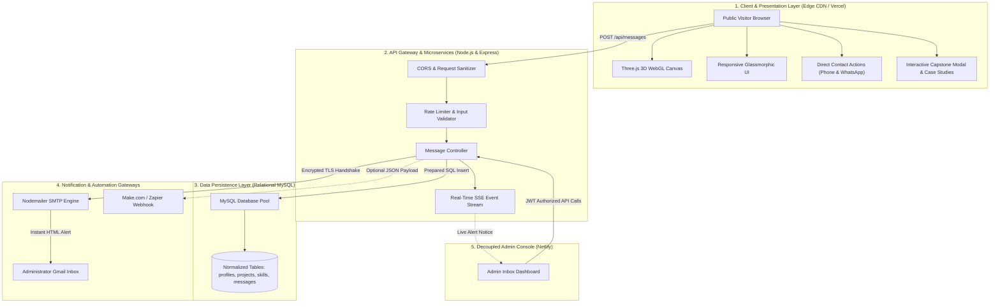
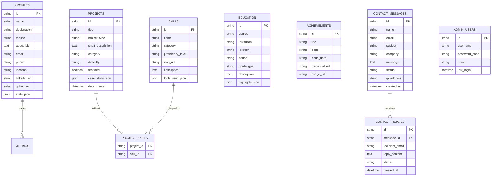
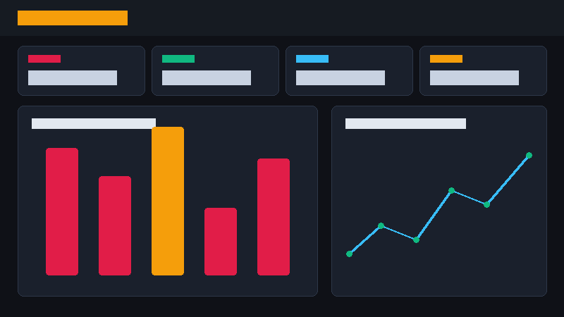
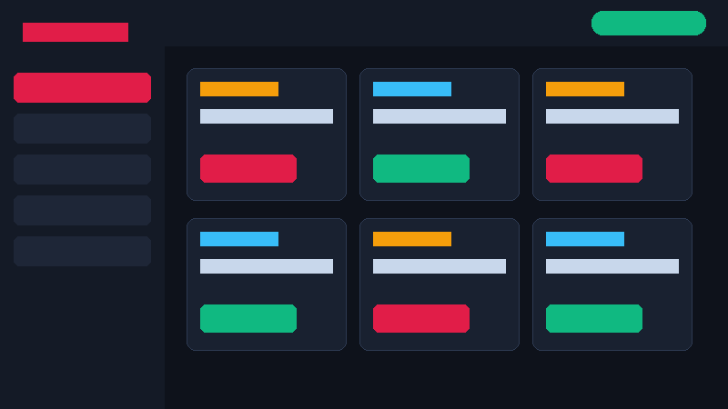
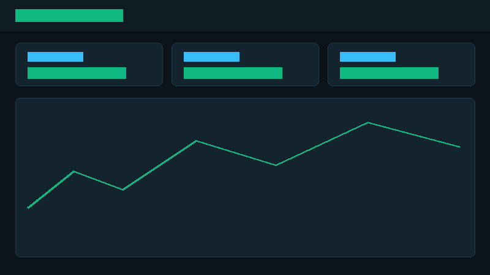

<div align="center">

# 📊 Sagar Singh — Data Analytics & Full-Stack Portfolio

**Production-grade, full-stack Data Analytics showcase featuring interactive 3D WebGL data visualizations, dynamic enterprise BI dashboards, automated Gmail SMTP notifications, and a decoupled relational architecture.**

[](https://ssportfoliomines.vercel.app/)
[](./PROJECT_DOCUMENTATION.pdf)

<br/>

[](https://react.dev/)
[](https://www.typescriptlang.org/)
[](https://vitejs.dev/)
[](https://tailwindcss.com/)
[](https://threejs.org/)
[](https://nodejs.org/)
[](https://expressjs.com/)
[](https://www.mysql.com/)
[](https://powerbi.microsoft.com/)
[](https://www.python.org/)

<br/>

</div>

---

## 🌐 Public Deployment

The public visitor portal is live, globally distributed via Edge CDN, and accessible at:

👉 **[https://ssportfoliomines.vercel.app/](https://ssportfoliomines.vercel.app/)**

> **Note on Security & Architecture:**  
> In compliance with enterprise security and zero-trust engineering principles, backend microservices, database clusters, and admin interfaces are strictly isolated. All client communication routes through secure, rate-limited cloud endpoints without exposing database credentials, internal connection strings, or administrative management endpoints.

---

## 📑 System Documentation & Architectural Blueprint (PDF)

A complete, 4-page executive specification document has been generated and compiled into this repository:

📄 **[Download PROJECT_DOCUMENTATION.pdf](./PROJECT_DOCUMENTATION.pdf)**

The blueprint includes:
- Executive Overview & Quantified Performance Benchmarks
- Full-Stack Multi-Tier Architectural Topology
- Entity-Relationship Diagram (ERD) with complete data dictionaries
- Automated Nodemailer SMTP Ingestion & Real-Time Event Pipelines
- Flagship Capstone Analytical Methodologies & DAX Formulae

---

## 🚀 Key Highlights & Architectural Features

### 1. 🌌 Interactive 3D WebGL Space (`Three.js`)
- Hardware-accelerated particle cloud simulation responding dynamically to pointer coordinates and scroll velocity.
- Translucent, glassmorphic UI cards (`backdrop-blur-xl`, low-opacity dark surfaces) allowing 3D depth to render smoothly throughout non-project sections.
- Embedded ambient acoustic sound engine (Guitar & Piano) with client-side mute/unmute state management.

### 2. 📊 Flagship Enterprise Capstones ($2.4M+ Analyzed)
- **Sales Performance & Customer Analytics Dashboard:** Evaluated 50,000+ enterprise sales transactions ($2.4M volume) utilizing Power BI, advanced DAX measures, automated ETL pipelines, and MySQL schema modeling.
- **PG Rental Housing Management Platform:** Full-stack relational database web app featuring role-based authentication, room allotment matrices, and billing logs.
- **Healthcare & Financial Risk Predictive Models:** Exploratory data analysis, inpatient length-of-stay bottleneck identification, and insurance claim risk indicators built in Python with Pandas & NumPy.

### 3. 📬 Automated Gmail Contact Suite (Nodemailer SMTP)
- **100% Free & Unlimited Email Notifications:** Form inquiries immediately establish an encrypted TLS SMTP connection, dispatching structured HTML notification emails directly to the administrator's personal inbox.
- **Real-Time SSE Alert Stream:** Concurrent Server-Sent Events push new inquiries instantly to the Admin Inbox with visual badge indicators.
- **Dual Direct Connectivity:** Instant WhatsApp deep-link with pre-configured greeting message alongside direct telephone dialer (`tel:`) support.

### 4. 🔒 Decoupled Zero-Trust Security
- **No Sensitive Credential Tracking:** `.env`, `.env.local`, JWT secrets, and database passwords are permanently excluded from version control (`.gitignore`).
- **Sanitized Templates:** Only `.env.example` templates with redacted placeholders are included in the repository.
- **Isolated User & Admin Surfaces:** Public visitors cannot access administrative routes or triggers. Admin authentication is guarded by bcrypt password hashing and cryptographic JSON Web Tokens.

---

## 🏛️ System Architecture & Workflow Flowchart

The diagram below outlines the end-to-end data lifecycle from visitor interaction to database persistence and automated email dispatch:



---

## 🗄️ Database Architecture & Entity-Relationship Diagram (ERD)

The database schema is fully normalized in MySQL, utilizing foreign key constraints, connection pooling, and automated schema migrations:



---

## 📸 Visual Showcase & Featured Modules

<div align="center">

### 📈 Flagship Sales Performance & Customer Analytics Dashboard
*Analyzed 50,000+ sales records representing $2.4M in total revenue with dynamic DAX metrics, customer cohorts, and profit margin analysis.*



<br/><br/>

### 🏢 Full-Stack PG Rental Management Web Application
*End-to-end relational database solution featuring room allotment, automated tenant billing, and query optimization.*



<br/><br/>

### 🏥 Healthcare Inpatient Analytics & Financial Risk Modeling
*Exploratory data analysis identifying length-of-stay bottlenecks and insurance claim denial patterns.*



</div>

---

## 🛠️ Technology Stack Breakdown

| Layer | Technologies |
| :--- | :--- |
| **Frontend Framework** | React 18, TypeScript, Vite |
| **Visuals & 3D WebGL** | Three.js, Lucide Vector Icons, Framer Motion (`motion/react`) |
| **Styling & Theme** | Tailwind CSS, Custom Glassmorphic Utilities, Responsive Mobile Sidebar |
| **Backend API** | Node.js (v24), Express.js, TypeScript, REST Architecture |
| **Relational Database** | MySQL 8, Connection Pool (`mysql2/promise`), Automated Migrations |
| **Realtime & Email** | Server-Sent Events (SSE), Nodemailer (Direct TLS SMTP) |
| **Data Analytics / BI** | Microsoft Power BI, Advanced DAX, Python (Pandas/NumPy), SQL |
| **Security & Auth** | JSON Web Tokens (JWT), Bcrypt Hashing, Rate Limiting, Input Sanitization |
| **Cloud Hosting** | Vercel (Edge Client), Netlify (Admin Console), Cloud Microservices |

---

## 📂 Repository Directory Layout

```text
├── docs/                               # Architectural documentation & assets
│   ├── PROJECT_DOCUMENTATION.pdf       # Compiled 4-page system architecture PDF
│   └── screenshots/                    # Featured capstone & UI preview visuals
├── public/                             # Static public assets (resume, logos, icons)
│   ├── projects/                       # High-resolution project thumbnail gallery
│   └── PROJECT_DOCUMENTATION.pdf       # Publicly downloadable blueprint
├── src/                                # Frontend source code (React 18 + TypeScript)
│   ├── components/                     # Modular UI components
│   │   ├── admin/                      # Decoupled administrative management portal
│   │   ├── AboutSection.tsx            # Executive biography & core pillars
│   │   ├── AiAssistantModal.tsx        # Multilingual conversational portfolio AI
│   │   ├── CaseStudyModal.tsx          # Full-screen deep-dive capstone view
│   │   ├── ContactSection.tsx          # Direct WhatsApp/Phone & Gmail contact form
│   │   ├── EducationAchievements.tsx   # Academic background & certified honors
│   │   ├── Hero.tsx                    # Interactive introduction with KPI statistics
│   │   ├── Navbar.tsx                  # Responsive navigation with body scroll lock
│   │   ├── ProjectsGallery.tsx         # Filterable capstone gallery with search
│   │   ├── ResumeSection.tsx           # Official verified curriculum vitae preview
│   │   ├── SkillsSection.tsx           # Technical competencies & 3D solar system
│   │   └── ThreeDataBackground.tsx     # Three.js WebGL particle space engine
│   ├── data/                           # Default fallback data models
│   ├── services/                       # Client API abstractions & email service
│   ├── types/                          # Type-safe TypeScript interfaces & schemas
│   ├── App.tsx                         # Root routing & environment orchestrator
│   └── main.tsx                        # React application DOM entry point
├── database/                           # MySQL database connection & migration scripts
│   ├── migrations/                     # Sequential SQL DDL schema files (001-004)
│   ├── services/                       # Data access object (DAO) query services
│   ├── connection.ts                   # Robust connection pool with offline fallback
│   └── migrator.ts                     # Automated migration runner
├── backend/                            # Standalone backend microservice distribution
├── .env.example                        # Sanitized configuration template
├── package.json                        # Node dependencies & automation scripts
├── PROJECT_DOCUMENTATION.pdf           # Root executive documentation PDF
├── README.md                           # Comprehensive public repository documentation
├── server.ts                           # Express application & API route handlers
├── tailwind.config.js                  # Tailwind utility & color definitions
├── tsconfig.json                       # Strict TypeScript configuration
└── vite.config.ts                      # Vite build & asset optimization settings
```

---

## 💻 Local Development Setup

To run the application locally on your workstation:

### 1. Clone the Repository
```bash
git clone https://github.com/Sagar99-cmyk/ssportfoliomine.git
cd ssportfoliomine
```

### 2. Install Dependencies
```bash
npm install
```

### 3. Configure Local Environment Variables
Copy `.env.example` to `.env`:

```bash
# Windows PowerShell
Copy-Item .env.example .env

# macOS / Linux
cp .env.example .env
```

Open `.env` and configure your local settings:
```env
PORT=3000
NODE_ENV=development
APP_URL=http://localhost:3000

# Optional Local MySQL Database (Fallback data runs automatically if disabled)
MYSQL_ENABLED=false
MYSQL_HOST=localhost
MYSQL_PORT=3306
MYSQL_USER=root
MYSQL_PASSWORD=your_password
MYSQL_DATABASE=sagar_portfolio_db

# Optional Gmail SMTP Integration
SMTP_HOST=smtp.gmail.com
SMTP_PORT=465
SMTP_SECURE=true
SMTP_USER=your_email@gmail.com
SMTP_PASS=your_16_char_google_app_password
EMAIL_FROM="Portfolio Inquiry <your_email@gmail.com>"
```

### 4. Start Development Servers
```bash
# Run both Frontend & Backend concurrently:
npm run dev
```

Visit **`http://localhost:3000`** in your browser.

---

## 🔒 Security & Contribution Guidelines

- **Responsible Disclosure:** If you identify any potential security vulnerabilities, please open an issue or reach out directly through the verified contact form on the portfolio.
- **Credential Protection:** Never commit `.env` files or API secrets. Ensure `.gitignore` remains active for all local testing.

---

## 👤 Author & Professional Contact

**Sagar Singh**  
*Data Analytics & Business Intelligence Specialist*  
Bengaluru, Karnataka, India

- 🌐 **Live Portfolio:** [https://ssportfoliomines.vercel.app/](https://ssportfoliomines.vercel.app/)
- 💼 **LinkedIn:** [linkedin.com/in/sagar-singh-939a31301](https://www.linkedin.com/in/sagar-singh-939a31301)
- 🐙 **GitHub:** [github.com/Sagar99-cmyk](https://github.com/Sagar99-cmyk)
- 📧 **Direct Inquiries:** Submit via the verified [Contact Form](https://ssportfoliomines.vercel.app/#contact)

---

<div align="center">
<sub>Designed, engineered, and maintained by Sagar Singh. All project datasets, analytical workflows, and capstones are verified.</sub>
</div>
