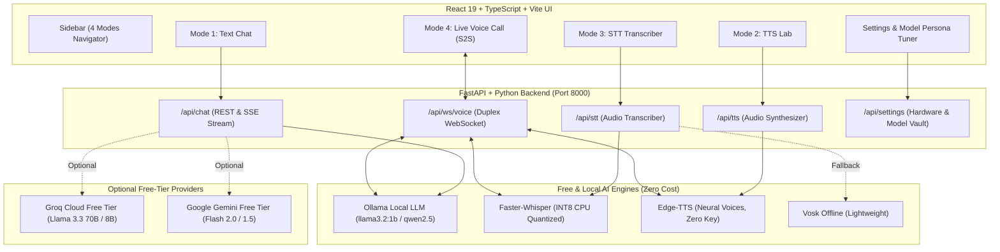

# 🎙️ OmniVoice AI — Free Multimodal AI Chatbot & Voice Assistant

A complete, production-grade, privacy-first AI Assistant application built with **React, TypeScript, Vite, Tailwind CSS, FastAPI, and WebSockets**. 

Supports **four major multimodal AI capabilities** designed to run with **zero required API costs**, optimized for standard laptops (Intel CPU, 8 GB RAM):

1. **Text-to-Text (T2T)**: Streaming chat with Markdown, code highlighting, and conversation history using local Ollama models (`llama3.2:1b`, `qwen2.5:0.5b`) with free-tier cloud fallback (Groq & Gemini).
2. **Text-to-Speech (TTS)**: High-fidelity natural voice synthesis using **Edge-TTS** (100% free, 40+ languages, zero API key) and local **Kokoro/Piper** models.
3. **Speech-to-Text (STT)**: High-accuracy microphone recording and audio file transcription with **Faster-Whisper** (INT8 CPU optimized) and **Vosk**.
4. **Speech-to-Speech (S2S)**: Real-time, full-duplex voice conversation over WebSockets with visual audio orb, streaming speech chunking, and live interruption.

---

## 🏛️ System Architecture



---

## 🚀 Quick Start Guide (Windows)

### Prerequisites
- **Node.js**: v18+ (verified with `v24.12.0`)
- **Python**: 3.10 to 3.14 (verified with Anaconda / python 3.14)
- **Ollama** (Optional, for 100% offline local inference): [https://ollama.ai](https://ollama.ai)

---

### Step 1: Backend Setup (FastAPI)

1. Open PowerShell or Command Prompt:
   ```powershell
   cd ai-multimodal-assistant/backend
   ```
2. Create and activate a Python virtual environment:
   ```powershell
   python -m venv .venv
   .\.venv\Scripts\activate
   ```
3. Install dependencies:
   ```powershell
   pip install -r requirements.txt
   ```
4. Start the FastAPI server:
   ```powershell
   uvicorn app.main:app --host 127.0.0.1 --port 8000 --reload
   ```
   *The backend will be live at [http://127.0.0.1:8000](http://127.0.0.1:8000) with interactive Swagger docs at [http://127.0.0.1:8000/docs](http://127.0.0.1:8000/docs).*

---

### Step 2: Frontend Setup (React + Vite)

1. In a second terminal window:
   ```powershell
   cd ai-multimodal-assistant/frontend
   ```
2. Install dependencies:
   ```powershell
   npm install
   ```
3. Start the Vite dev server:
   ```powershell
   npm run dev
   ```
4. Open your browser at:
   ```
   http://localhost:5173
   ```

---

## 💻 Hardware Strategy for 8 GB RAM / CPU Laptops

Because this machine operates with **8 GB RAM and CPU inference** (no dedicated NVIDIA CUDA GPU), running heavy 7B+ models directly in local RAM can cause high memory pressure.

We designed the application to be **fast, responsive, and lightweight**:

| Capability | Recommended Engine | RAM Footprint | Performance on 12-core CPU |
| :--- | :--- | :---: | :---: |
| **Local LLM** | Ollama `llama3.2:1b` or `qwen2.5:0.5b` | ~1.2 GB | ~25 tokens/sec |
| **Free Cloud LLM** | Groq (Llama 3.1 8B Instant) | 0 GB (Cloud) | ~200 tokens/sec |
| **Speech-to-Text** | Faster-Whisper `tiny` (INT8 CPU) | ~150 MB | Sub-second audio transcription |
| **Text-to-Speech** | Edge-TTS (Jenny, Guy, Sonia, Swara) | ~40 MB | Real-time audio streaming |

---

## 🧠 Model Training & Custom Persona Tuning

Under the **Settings & Models** page, you can customize:
1. **Model Persona Tuning**: Define the AI's exact system prompt, expertise, tone, and behavioral rules (e.g. Senior Software Mentor, Data Analytics Specialist, or Language Tutor).
2. **Temperature & Creativity**: Slide from `0.0` (strict, deterministic) to `1.0` (creative, conversational).
3. **Provider Flexibility**: Toggle freely between Local Ollama and Free-tier Cloud APIs with a single click.

---

## 🔒 Security & Privacy Guarantees
- **Zero API Key Leakage**: API keys (Groq, Gemini) are handled exclusively on the backend and never exposed to client-side JavaScript.
- **Local-First Default**: The application defaults to Ollama and Edge-TTS with zero external tracking.
- **Explicit Consent**: External cloud APIs are only contacted if the user explicitly configures and selects them.

